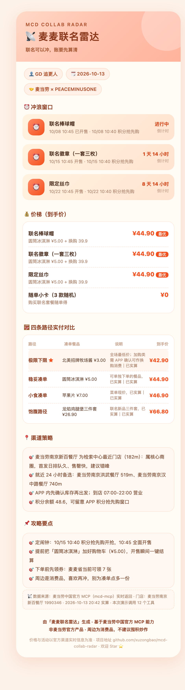

# 📡 麦麦联名雷达 · mcd-collab-radar

> **联名可以冲，账要先算清。**
> 麦当劳限定联名的抢购参谋——把「窗口、价梯、渠道」三本账算明白，再甩你一张能晒的攻略卡。

当下最典型的场景：**麦当劳 × PEACEMINUSONE（G-DRAGON）联名**——韩式新品 + 周边多弹发售（小卡 → 徽章 → 丝巾）。输入你在追的联名，它还你一张结构化情报表 + 一张可截图分享的攻略卡。

🏷️ **麦当劳程序员创意开发大赛**参赛作品 · 基于麦当劳中国官方 MCP（mcd-mcp）开发 · 使用 WorkBuddy 辅助开发


⚠️ 本项目为参赛者独立开发的**非麦当劳官方产品**，输出仅供参考；周边为消费品，不建议囤积炒作。

---

## ✨ 解决什么问题

联名周边开售那天，小红书上一半人在喊"抢破头"，一半人在喊"没人买"——**信息差才是真正的成本**。麦麦联名雷达用 MCP 实时数据，把一次联名抢购拆成三个可执行的问题：

| 账本 | 回答什么问题 | 数据来自 |
|---|---|---|
| ⏰ **窗口** | 什么时候冲？开售/积分抢先购时刻、倒计时 | `campaign-calendar` 实时活动日历 |
| 💰 **价梯** | 怎么买最便宜？换购/加购/麦金卡/积分，哪条路径到手价最低 | `query-meals` + `calculate-price` + 券 + 积分 |
| 📍 **渠道** | 去哪买？附近门店雷达 + 痛店/冷店错位策略 | `query-nearby-stores` + 门店券对比 |

最后生成一张**小红书风攻略卡**，截图就能发——手慢的人，连攻略都是借来的。

## 🎯 为什么不是又一个点餐 Skill

点餐助手回答「今天吃什么」，我们回答完全不同的问题：

| | 点餐类 Skill | 麦麦联名雷达 |
|---|---|---|
| 场景 | 日常用餐决策 | **限定联名抢购**（一次性、强时效、信息差最大） |
| 输出 | 菜单/优惠券 | 三本账 + **一张能晒出去的攻略卡** |
| 时效 | 随时 | 倒计时驱动，开售/积分抢先购窗口精确到分钟 |
| 数据 | 菜单快照 | `calculate-price` 逐条实算 + 门店实时距离/营业状态 |

且不绑死任何单次联名——以 `campaign-calendar` 为活水源，**下一个联名上线即自动纳入雷达**。

## 🔬 真实运行样例（2026-10-13 19:53 · MCP 实时数据）



以上为 Skill 一次完整跑通的真实输出，全部数据来自麦当劳中国官方 MCP 实时返回，价格经 `calculate-price` 实算：

**联名情报表**（`campaign-calendar` 提取）

| 联名/活动 | 周边清单 | 开售时间 | 积分抢先购 | 状态 |
|---|---|---|---|---|
| 麦当劳 × PEACEMINUSONE | 复古棒球帽 / 联名徽章（一套三枚）/ 限定丝巾 / 小卡 | 10:45 | 10:40 | 棒球帽已开售；徽章 1 天后；丝巾 8 天后 |

**窗口账**（`now-time-info` 校准倒计时）

| 周边 | 开售 | 积分抢先购 | 倒计时 |
|---|---|---|---|
| 联名徽章 | 10/15 10:45 | 10/15 10:40 | 1 天 14 小时 |
| 限定丝巾 | 10/22 10:45 | 10/22 10:40 | 8 天 14 小时 |

**价梯账**（门店：麦当劳南京新百餐厅 `1990346`，`query-meals` + `calculate-price` 逐条实算；周边机制 = 任意餐品消费 +39.9 元换购）

| 路径 | 凑单餐品 | 餐品价 | 到手价 | 说明 |
|---|---|---|---|---|
| 极限下限 | 北美招牌牧场酱 | ¥3.00 | ¥42.90 | 全场最低价，已实算；加购类能否作为换购所需"餐品消费"需 APP 确认 |
| 稳妥凑单 ★ | 圆筒冰淇淋 | ¥5.00 | **¥44.90** | 可单独下单，已实算（500 分） |
| 小食凑单 | 苹果片 | ¥7.00 | ¥46.90 | 已实算 |
| 饱腹路径 | 龙焰鸡腿堡三件套 | ¥26.90 | ¥66.80 | 联名新品三件套，已实算（2690 分） |

> 账户积分余额 48.6（`query-my-account`）；周边未出现在积分商城兑换列表（在架 50 个商品），机制确认为换购而非积分兑换——**优化目标是把凑单餐品压到最便宜，而不是攒积分**。

**渠道账**（`query-nearby-stores`，中国南京新街口）

| 门店 | 距离 | 营业时间 |
|---|---|---|
| 麦当劳南京新百餐厅 | 182 m | 07:00–22:00 |
| 麦当劳南京洪武餐厅 | 519 m | 00:00–23:59（24 h） |
| 麦当劳南京青奥城市客厅餐厅 | 645 m | 07:00–23:00 |
| 麦当劳南京新街口苏宁餐厅 | 645 m | 07:00–23:00 |
| 麦当劳南京汉中路餐厅 | 740 m | 00:00–23:59（24 h） |

策略：新街口属核心商圈（痛店），首发日排队久、售罄快；就近 24 小时店（洪武、汉中路）是更稳的备选。

完整攻略卡见 [`demo/sample-card.html`](./demo/sample-card.html)（浏览器打开即可截图），渲染输入见 [`demo/plan.json`](./demo/plan.json)。

## 🧪 一键复现：实盘演示脚本

上面这套数据不是手写的——由 [`scripts/live_demo.py`](./scripts/live_demo.py) 编排 8 类 MCP 工具自动跑出，**克隆仓库即可复现**：

```bash
# 实盘模式（需要 MCP Token）
export MCD_MCP_TOKEN="你的Token"
python3 scripts/live_demo.py --city 南京市 --keyword 新街口

# 离线回放模式（无需 Token，仓库内置录制数据，账户 ID 已脱敏）
python3 scripts/live_demo.py --dry-run
```

每次运行产出「演示报告 + 攻略卡 + 每次工具调用的原始返回（可审计）」。联名开售当天还能定时起跑抓第一手数据：

```bash
python3 scripts/live_demo.py --wait-until 10:40    # 等到积分抢先购窗口再跑
```

| 特性 | 说明 |
|---|---|
| 纯标准库零依赖 | 只用 Python 3 标准库 |
| 价格必须实算 | 每条价梯路径都调 `calculate-price`，拿不到实算结果会明确标注 |
| 失败降级不中断 | 单工具失败只跳过该步并在报告标注 |
| Token 不进产物 | Token 只从环境变量读取，产物里只有 API 返回 |
| 温和调用 | 每次间隔 250ms，远离 600 次/分钟限流 |

详细说明见 [`demo/README.md`](./demo/README.md)。

## 👤 目标用户

- **追限定周边的粉丝/潮人**：K-pop 粉丝、潮玩收集者（当下：GD 联名三连弹）
- **羊毛党**：想用最低成本拿到周边的精明消费者
- **选择困难户**：面对"换购 or 加购、哪家店、要不要定闹钟"不想做功课的人

## 🚀 安装与使用

### 前置条件

1. 支持 MCP 的客户端（推荐 **WorkBuddy**，本项目即在其上开发）
2. 麦当劳中国 MCP Token：[https://open.mcd.cn/mcp](https://open.mcd.cn/mcp) → 手机号登录 → 控制台 → 激活 → 复制

### 第一步：配置麦当劳 MCP

复制 [`mcp-config.example.json`](./mcp-config.example.json)，把 `${MCD_MCP_TOKEN}` 替换为真实 Token（或用环境变量注入）：

```json
{
  "mcpServers": {
    "mcd-mcp": {
      "type": "streamablehttp",
      "url": "https://mcp.mcd.cn",
      "headers": {
        "Authorization": "Bearer ${MCD_MCP_TOKEN}"
      }
    }
  }
}
```

### 第二步：加载 Skill

将本仓库的 `SKILL.md` 及 `references/`、`scripts/` 作为 Skill 加载到 WorkBuddy（或任何支持 Agent Skill 的客户端）。

### 第三步：开始对话

```
现在麦当劳有什么联名？周边都什么时候开售，怎么买最划算？
```

或：

```
我在追 GD 联名，帮我算算徽章和丝巾的最优购买路径，我在北京五道口
```

Skill 会自动完成：扫雷达 → 算三本账 → 出攻略卡。

## 📁 项目结构

```
mcd-collab-radar/
├── SKILL.md                        # Skill 主体：三步工作流（扫雷达→算账→出卡）
├── references/
│   ├── workflow.md                 # 三步工作流详解与话术
│   ├── price-ladder.md             # 价梯计算规则（联名周边购买机制拆解）
│   └── collab-playbook.md          # 联名玩法与攻略卡内容规范
├── scripts/
│   ├── live_demo.py                # 实盘演示编排器：一键跑通全流程并产出可审计数据
│   └── render_collab_card.py       # 联名攻略卡渲染器（纯标准库零依赖）
├── demo/
│   ├── README.md                   # 演示目录使用说明
│   ├── sample-card.html            # 示例攻略卡（真实数据渲染，浏览器打开即可截图）
│   ├── sample-card.png             # 示例攻略卡截图（README 首屏同款）
│   ├── plan.json                   # 示例攻略卡的渲染输入（真实 MCP 数据结构）
│   └── fixtures/raw/               # 离线回放数据（真实返回录制，账户 ID 已脱敏）
├── MCP_INTEGRATION.md              # MCP 接入说明（Server/Tool/流程/价值）
├── mcp-config.example.json         # 脱敏 MCP 配置示例（仅环境变量占位符）
├── CONTEST_DECLARATION.md          # 参赛声明（官方模板原文）
├── workbuddy.md                    # WorkBuddy 开发对话上下文
└── README.md
```

## 🧩 使用的麦当劳 MCP 工具

共 15 个：`campaign-calendar`、`now-time-info`、`mall-points-products`、`mall-product-detail`、`query-lottery-info`、`query-nearby-stores`、`query-meals`、`query-meal-detail`、`calculate-price`、`query-store-coupons`、`available-coupons`、`auto-bind-coupons`、`query-my-account`、`query-my-prizes`、`order-list`

详细调用流程与业务价值见 [MCP_INTEGRATION.md](./MCP_INTEGRATION.md)。

## 🔒 安全与边界

- **不代抢、不碰二手**：只规划本人在官方渠道的自用购买路径，不做任何投资/炒作建议
- 领券等写操作必须经用户明确确认；配置**仅用环境变量占位符**，仓库不含任何真实 Token
- 活动、价格、优惠一律以 MCP 实时返回为准，不编造
- 本项目为非麦当劳官方产品，不提及其他品牌

## 🏆 参赛信息

- **赛事**：麦当劳程序员创意开发大赛（1024 程序员节专项）
- **赛事仓库**：https://github.com/M-China/mcd-developer-innovation-challenge
- **开发工具**：WorkBuddy（官方合作伙伴），对话上下文见 [workbuddy.md](./workbuddy.md)

## 📄 License

MIT
